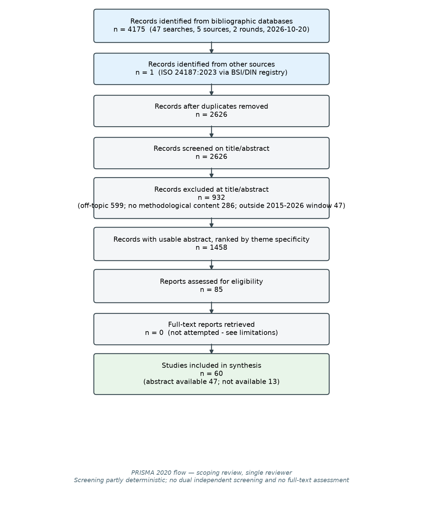

# Identification, shape, polymer type and quantification of microplastics: a scoping review

**Review type:** scoping review with a documented, reproducible search (single reviewer)
**Search date:** 2026-10-20
**Databases searched:** OpenAlex, Crossref, Europe PMC, PubMed, Europe PMC preprint index
**Studies included:** 60 (abstract available for 47)
**Protocol registration:** none (not registered; a deviation from systematic-review practice, disclosed in §8)
**Working data:** `runs/litreview_v1/` — search manifest, raw responses, screening table, PRISMA counts

---

## Abstract

Microplastic analysis has no single accepted method, and its four core outputs — identity, shape, polymer type and quantity — are produced by method families that are not interchangeable and do not agree between laboratories. This review synthesises 60 studies retrieved through a two-round search of five bibliographic sources (60 included of 4,175 records identified). The strongest findings are: (i) fluorescence staining with Nile Red is a *screening* method whose signal is polarity-based, so it cannot establish polymer identity and inflates counts unless a second stain excludes biological material; (ii) shape is the least standardised quantity in the field, with definitions described as "ambiguous and inexplicit", for which a nine-category expert-validated taxonomy now exists; (iii) particle size should be reported as maximum Feret's diameter, and detection probability collapses with size (50% at 40 µm, 90% at 100 µm in one benchmarked fluorescence-plus-machine-learning system); (iv) no fully validated analytical method for microplastic quantification exists, interlaboratory agreement on polymer type ranges from 53% to 100%, and size distributions are uncertain enough that smoothing with a running mean above 0.5 mm has been recommended. For an image-based counting and sizing pipeline the decisive implication is that detection probability, calibration uncertainty, recovery and blank correction must be modelled explicitly, and that deep-learning segmentation of real fluorescent microplastic images currently achieves mean F1 ≈ 0.74, not the ≈0.98 typical of synthetic phantoms.

---

## 1. Introduction

### 1.1 Background
Microplastics (plastic particles below 5 mm) are sampled from water and sediment, separated by density, filtered, and then characterised. Characterisation answers four questions: *is this a plastic?*, *what shape is it?*, *what polymer is it?*, and *how much is there?* Each is answered by a different instrument family, with different detection limits, different units and different failure modes.

### 1.2 Rationale
An image-based pipeline that counts and sizes particles must decide which of these questions it can answer and with what uncertainty. The methodological literature is unusually self-critical about this, and its conclusions constrain design choices — which is why a review precedes the architecture rather than following it.

### 1.3 Objectives and review question
**Question.** What does the retrieved literature establish about (a) identification, (b) shape and morphology, (c) polymer-type determination and (d) quantification with its uncertainty, for microplastics in environmental water and sediment — and what does that imply for an image-based counting and sizing pipeline?

---

## 2. Methods

### 2.1 Eligibility criteria
**Inclusion:** (IC1) concerns microplastics, nanoplastics or plastic debris; (IC2) contains content on at least one of the four themes (identification, shape/morphology, polymer type, quantification/QA-QC/harmonisation); (IC3) peer-reviewed article, review, tool or preprint with retrievable metadata; (IC4) published 2015–2026 (the window after the canonical methodological appraisal of Löder & Gerdts 2015).

**Exclusion:** (EC1) no microplastics term in title or abstract; (EC2) no methodological, measurement or standardisation content; (EC3) outside the 2015–2026 window; (EC4) duplicate record (linked by DOI or normalised title, counted once).

### 2.2 Information sources
Five sources were searched on 2026-10-20: OpenAlex, Crossref, Europe PMC, PubMed, and the Europe PMC preprint index (`SRC:PPR`, covering bioRxiv/medRxiv/chemRxiv/EarthArXiv). Full search strings, per-query hit counts and raw responses are in `runs/litreview_v1/sources/`.

### 2.3 Search strategy
Two rounds. Round 1: eight theme queries across all five sources. Round 2 refined two sources whose round-1 semantics were unusable — Crossref's `query.bibliographic` is a fuzzy relevance query whose `total-results` is not a meaningful hit count (4.1M for one string, 0 for another), and arXiv returned zero for every phrase query and then HTTP 429, so preprints were routed through Europe PMC's preprint index instead. Search strings are listed in Appendix A.

### 2.4 Selection process
Screening was **single-reviewer**. Stage 1 applied deterministic rules (topic term, methodological term, date window) and recorded a reason for every exclusion. Because stage 1 is deliberately permissive, stage 2 ranked the surviving records by *theme specificity* — a record qualified as a theme candidate only if it was retrieved by a query belonging to that theme **and** its text names that theme's instrument or metric. The final included set was then selected by the reviewer from those shortlists.

### 2.5 Data extraction
For each included study: citation, DOI, themes, evidence type, scope/matrix, method family, key quantitative result, relevance to the pipeline, and quality flags. Extracted in `extraction_table.csv`.

### 2.6 Quality appraisal
No formal risk-of-bias instrument (RoB 2, AMSTAR 2) applies to a methodological scoping review of this kind, so four domain-appropriate flags were recorded per study: reports validation/accuracy/recovery; reports uncertainty or confidence; interlaboratory design; sample size reported. Results in §3.3.

### 2.7 Synthesis
Thematic (by the four themes plus a cross-cutting automated-analysis theme), not study-by-study.

### 2.8 Deviations from protocol
Round 2 was added after round 1 (source-semantics defect); arXiv was abandoned for HTTP 429 and replaced by the Europe PMC preprint index; full-text assessment was not performed (see §8).

---

## 3. Results

### 3.1 Study selection

| Stage | n |
|---|---|
| Records identified from databases | 4,175 |
| — OpenAlex / Crossref / Europe PMC / PubMed / Europe PMC preprints | 1,493 / 900 / 1,314 / 191 / 277 |
| Records identified from other sources | 1 (ISO 24187:2023, via BSI/DIN registry records) |
| Duplicates removed | 1,549 |
| Records screened (title/abstract) | 2,626 |
| Excluded at title/abstract | 932 |
| — off-topic (no microplastics term) / no methodological content / outside window | 599 / 286 / 47 |
| Records with usable abstract, ranked by specificity | 1,458 |
| Reports assessed for eligibility | 85 |
| **Studies included in synthesis** | **60** |

### 3.2 Characteristics of included studies
By evidence type: method-development 24, method-comparison 11, interlaboratory 4, critical review 3, tool 3, reference-material 2, method-review 2, review 2, and one each of mechanistic review, conceptual, guidance/review, reference-methodology, method-integration, preprint, method-evaluation, benchmark-review. Theme coverage: quantification 21, identification 19, automated imaging 14, shape 13, polymer type 11.

### 3.3 Quality appraisal
| Flag | Studies |
|---|---|
| Reports validation / accuracy / recovery | 47 / 60 |
| Reports uncertainty or confidence | 15 / 60 |
| Interlaboratory design | 5 / 60 |
| Sample size reported | 32 / 60 |

**Interpretation.** Validation is common; **uncertainty reporting is not** (15 of 60). Only five studies are interlaboratory, and those five carry most of the field's evidence about reliability. This asymmetry — abundant single-laboratory validation, scarce uncertainty and cross-laboratory evidence — is itself a finding.

---

## 4. Synthesis by theme

### 4.1 Identification: fluorescence screens, spectroscopy decides
Nile Red is the workhorse of rapid identification, and the literature is explicit about its ceiling. Stanton et al. (2019) showed it stains "a variety of microplastic particles **and** common natural and anthropogenic particles", so estimates are inflated unless a second stain excludes biological material — their DAPI costaining is the remedy. Ho et al. (2023) explain why this is structural: Nile Red emission is a **polarity** signal, not a chemical one. Wallner et al. (2026) add a confounder: the colour and peak emission wavelength of some stained environmental particles were **affected by additives**, so colour-based classification is unstable.

Two consequences for automation. First, the honest output of a Nile Red pipeline is a *polarity class with abstention*, not a polymer name. Second, confirmation is a separate instrument: Kukkola et al. (2023) validate fluorescence-identified particles with micro-FTIR or Raman, and Kukkola also publishes a **morphology-specific identification key** plus detection limits for nine polymers and **five natural substrates that produce false-positive Nile Red signals** — the calibration protocol an automated system needs. Fluorescence-guided Raman (2025) formalises this as a two-stage screen-then-confirm workflow.

The most transferable quantitative result is Tanoiri et al. (2026): with fluorescence plus machine learning, **detection probability was 50% for 40 µm particles and 90% for 100 µm particles**. Detection probability is a function of particle size, and any counting claim must state it.

### 4.2 Shape and morphology: the least standardised quantity
Liu et al. (2023) state the problem directly: shape definitions are "ambiguous and inexplicit, leading to incomparability across data", and they answer it with an expert survey yielding nine validated categories — **fiber, rod, ellipse, oval, sphere, quadrilateral, triangle, free-form, unidentifiable** — scored by five experts over **11,042 particles** from seven matrices. This is the taxonomy to adopt.

Size has a clearer standard. Schnepf et al. (2023) conclude size should be estimated via **maximum Feret's diameter**, and that current measurement is "neither comprehensive nor harmonized, making the data ineligible for risk assessment". von der Esch et al. (2020) implement exactly this (Feret min/max, area, coordinates) in TUM-ParticleTyper, and Richter et al. (2022) publish a reference methodology for size *distribution* covering sampling, filtration, microscopy and image processing.

Three measurement confounders recur. Fang et al. (2023) show the reported size distribution depends on the **dispersant** — water is a poor dispersant for many polymers, ethanol is preferred. Fritz et al. (2024) must compensate for **uneven illumination and low contrast** and handle **stacked particles** in their Octave algorithm — the same failure modes a tiled pipeline meets at seams. Kim et al. (2023) use flow imaging microscopy with custom libraries. And Szakas et al. (2026) show mass-based single-particle ICP-TOFMS must *assume spherical geometry* to convert mass to diameter, so imaging supplies the shape that mass-based methods depend on.

### 4.3 Polymer type: reliable in bulk, fragile in the tail
Spectroscopic library matching is the reference method, and database design determines its ceiling (Primpke et al. 2018). Interlaboratory evidence says polymer typing is comparatively reliable — van Mourik et al. (2021) report that across 34 laboratories using 7 methods, "the majority of the labs (53–100%) correctly identified the type of polymer in all samples but one". The tail of that range is the honest headline.

The failure modes are specific: chemically similar polymers that share functional groups, combined with imbalanced datasets and spectral fouling, reduce classification accuracy (Yan et al. 2022); polyethylene quantification suffers **false positives from lipid interference** in biological matrices, requiring a dedicated Py-GC-MS/MS method (Nono Almeida et al. 2025); and two automated tools applied to the same large FTIR dataset had never been compared, with "little known about the comparability or the level of reliability of their output" (Moses et al. 2023). Dong et al. (2022) ask whether automated vibrational pipelines even report the same metrics.

Polymer identity is also a **finer question than it appears**: Forakis et al. (2025) show that "polyester" is a class (PET, PBT, PCT, PEN), that household polyester products are often *assumed* rather than verified to be PET, and that phthalate additives are detectable by double-shot Py-GC/MS. Meanwhile Primpke et al. (2020) demonstrate that Py-GC/MS and hyperspectral FTIR, measured on the same samples consecutively, produce **mass-related vs particle-number-related** datasets whose composition trends can differ.

### 4.4 Quantification: no validated method, and error in both directions
Vitali et al. (2023) state the position without hedging: "**no fully validated analytical method is available** for microplastic quantification". Their own validated Nile Red + fluorescence + Random Forest workflow uses **partial interrogation of the filter** — the extrapolation step.

Interlaboratory studies bound the disagreement. Isobe et al. (2019), 12 laboratories: uncertainty arose from **inaccuracies in size measurement and misidentification, including both false recognition and overlooking**, and size distributions should be smoothed with a running mean **above 0.5 mm**. Ciornii et al. (2025) benchmark 84 laboratories across five methods using PET and PE reference materials of 10–200 µm under the VAMAS prestandardisation platform. Tsangaris et al. (2021) harmonise extraction from biota.

The QA/QC apparatus now exists to support this. Martínez-Francés et al. (2023) describe dissolvable gelatin capsules and soda tablets carrying **PET, PVC, PE, PS in 50–1000 µm fractions**, used across international interlaboratory studies; a water reference material with homogeneity evaluation is also published (2021). Contamination control is treated as *the* central challenge (Prata et al. 2020), and Munno et al. (2023) characterise what actually appears in **blanks**.

Two extraction findings transfer directly. Gran et al. (2025): saturated **CaCl₂ with decantation recovered 90 ± 1%** of microplastics regardless of polymer, size or shape, high-density polymers were harder to recover with low-density solutions, and **shape affected PET fibre recovery** specifically. Vermeiren et al. (2020) give a validated three-stage protocol for **organic-rich, fine-grained sediments** using Fenton's reagent, compatible with later FTIR. Ccanccapa-Cartagena et al. (2025) report Py-GC/MS limits of detection from **0.01 µg (PS) to 2.59 µg (PE)** and show that analysing the **entire filter was more accurate than extrapolating from subsections**.

### 4.5 Automated image analysis: the realistic ceiling
Park et al. (2022) trained U-Net variants on ≥20,000 patches from **99 fluorescence microscopy images** of microplastics and report, for the best model (MP-Net, with test-time augmentation), **mean F1 = 0.736 and mean IoU = 0.617**. That is the state of the art for this exact task, and it should calibrate every expectation in an image-based pipeline.

Adjacent evidence supports the same picture: Lorenzo-Navarro et al. (2020) on counting and classification; Shi et al. (2022) on 237 SEM micrographs (fragments/beads 50 µm–1 mm, fibres ≈10 µm diameter); Phan et al. (2023) comparing unsupervised, weakly-supervised and supervised approaches for particles <100 µm **without pixel-wise labels**; Massarelli et al. (2021) with a computer-vision plus kNN application counting into four morphology and size categories. Generalist microscopy segmentation is validated for autofluorescence images (Cellpose, 2025) and benchmarked against foundation models (2026), with ZeroCostDL4Mic (2021) lowering the training barrier.

---

## 5. Standards and regulatory context

- **ISO 24187:2023**, *Principles for the analysis of microplastics present in the environment* — verified through registry records: adopted by BSI as *Principles for the analysis of microplastics present in the environment* (10.3403/30399541) and by DIN as **DIN EN ISO 24187:2024-04** referencing **ISO 24187:2023** (10.31030/3495706), superseding the 2022-01 edition (10.31030/3309016). *Document contents were not retrieved in this review.*
- **ASTM D8332 / D8333** — sampling and analysis standards for microplastics in water, verified indirectly through a 2025 comparison of ASTM against in-line sampling (10.1186/s43591-025-00124-x). *Not retrieved directly.*
- **Regulatory driver.** Primpke et al. (2020) note that the 2018 California bill requested analysis of microplastics in drinking water by **standardised operational protocols**, which is why harmonisation is not purely academic.
- **GESAMP guidelines (2019)** are widely cited in this literature but their document metadata **could not be verified** in this pass; no claim about their contents is made here.

---

## 6. Implications for an image-based counting and sizing pipeline

1. **"Identify" must mean polarity class plus abstention, with a spectroscopic confirmation path on a subsample.** Grounded in Stanton et al. (2019), Ho et al. (2023), Kukkola et al. (2023). The unassignable fraction is a reportable result.
2. **Report size as maximum Feret's diameter**, citing Schnepf et al. (2023); adopt Liu et al.'s (2023) nine-shape taxonomy rather than an ad-hoc vocabulary.
3. **State detection probability as a function of particle size.** Tanoiri et al. (2026) supply the shape of that curve (50% at 40 µm, 90% at 100 µm). A pipeline that reports counts without it is reporting an unquantified censoring.
4. **Model the sampling chain, not just the image.** Recovery (Gran et al. 2025: 90 ± 1%, shape-dependent for fibres), extraction protocol (Vermeiren et al. 2020), blanks (Prata et al. 2020; Munno et al. 2023), reference-material spike recovery (Martínez-Francés et al. 2023).
5. **Prefer whole-filter analysis to subsample extrapolation**, or record the imaged fraction and propagate it (Ccanccapa-Cartagena et al. 2025 vs Vitali et al. 2023).
6. **Calibrate per image and publish the detection limits per polymer and per false-positive substrate** (Kukkola et al. 2023), since measured size scales linearly with the scale factor.
7. **Calibrate expectations with Park et al. (2022)**: mean F1 ≈ 0.74 on real fluorescence microscopy. Synthetic-phantom performance is not evidence of field performance.
8. **Score errors in both directions** — false recognition *and* overlooking (Isobe et al. 2019) — and consider the >0.5 mm running-mean smoothing they recommend for size distributions.
9. **Report uncertainty and validate against reference materials.** Only 15 of 60 included studies report uncertainty; that gap is the field's, and inheriting it would make a pipeline's numbers non-comparable.
10. **Do not assume the polymer identity of a fibre.** "Polyester" is a class (Forakis et al. 2025), and PE quantification in organic matrices has named false-positive mechanisms (Nono Almeida et al. 2025).

---

## 7. Evidence gaps

- **Sim-to-real gap unquantified.** No retrieved study trains only on synthetic/rendered microplastic images and reports the performance drop on real filters. The comparison must be inferred from Park et al. (2022) versus synthetic-phantom results.
- **PP vs LDPE confusion not quantified.** The mechanisms are documented (Yan et al. 2022: shared functional groups, imbalance, fouling) but no retrieved source reports a confusion rate between these two polyolefins specifically.
- **Size-dependent detection probability is rarely reported.** One strong source (Tanoiri et al. 2026); this should be routine.
- **Counting error is under-reported relative to classification error.** Most imaging work reports segmentation or classification metrics, not count bias per image.
- **No retrieved interlaboratory study on image-based counting.** The five interlaboratory studies cover spectroscopy, thermoanalysis and extraction, not automated image analysis.

---

## 8. Limitations of this review

1. **Single reviewer.** No dual independent screening or eligibility decisions; no disagreement resolution. This is the largest methodological limitation.
2. **No full-text assessment.** Eligibility was judged from title, abstract and metadata; 0 full-text reports were retrieved. Extraction for the **13** studies without a deposited abstract is recorded as *not extracted* rather than inferred.
3. **Screening was partly deterministic**, so stage-1 exclusions depend on the keyword patterns in `screen.py` rather than on judgement.
4. **Coverage is not exhaustive.** Relevance-ranked retrieval was capped per query (200 for OpenAlex/Europe PMC/PubMed, 100 for Crossref), so highly relevant records ranked below the cap are missing. Crossref's reported totals are not interpretable and were not used as counts.
5. **No protocol registration** and no PRISMA-P; the review was scoped retrospectively.
6. **Grey literature was not systematically searched.** Web search engines returned degraded results (bot blocking) and `parallel-cli` was unavailable (no `PARALLEL_API_KEY`), so standards were verified through registry records where possible and left marked unverified otherwise.
7. **Language and date limits:** English-language records; 2015–2026.
8. **Citation counts** are OpenAlex values on 2026-10-20 and were used only for ordering, never for eligibility.

---

## 9. Conclusion

The retrieved literature supports a clear division of labour for an image-based microplastic pipeline. Fluorescence imaging is a legitimate, cheap, high-throughput **counting and sizing** method whose identity output is limited to a polarity class with abstention; polymer identity belongs to vibrational spectroscopy or pyrolysis, with known failure modes and 53–100% interlaboratory agreement; shape needs a published taxonomy and size needs Feret's maximum; and quantification requires a modelled chain — recovery, blanks, detection limit and detection probability — rather than a raw count. The single most consequential number for pipeline design is Park et al.'s (2022) mean F1 of 0.736 for deep-learning segmentation of real fluorescent microplastic images, because it bounds what a learned counting model can be expected to achieve on real filters.

---

## References

- Ahmed M. Othman et al. (2023). *Detection of Sub-20 μm Microplastic Particles by Attenuated Total Reflection Fourier Transform Infrared Spectroscopy and Comparison with Raman Spectroscopy*. ACS Omega. https://doi.org/10.1021/acsomega.2c07998
- Albert A. Koelmans et al. (2022). *Risk assessment of microplastic particles*. Nature Reviews Materials. https://doi.org/10.1038/s41578-021-00411-y
- Alexander Ccanccapa-Cartagena, Anandu Nair Gopakumar & Maryam Salehi (2025). *A straightforward Py-GC/MS methodology for quantification of microplastics in tap water*. MethodsX. https://doi.org/10.1016/j.mex.2025.103173
- Alicia Gran et al. (2025). *Comparing methods for optimising microplastic extraction in sediment through density separation*. Environmental Pollution. https://doi.org/10.1016/j.envpol.2025.126894
- Anna T. Kukkola et al. (2023). *Easy and accessible way to calibrate a fluorescence microscope and to create a microplastic identification key*. MethodsX. https://doi.org/10.1016/j.mex.2023.102053
- Anna T. Kukkola et al. (2025). *Fluorescence-Guided Raman Spectroscopy with an Integrated Adapter for Faster and Cost-Effective Microplastic Detection*. Analytical Chemistry. https://doi.org/10.1021/acs.analchem.5c04637
- Ann‐Kathrin Kniggendorf, Christoph Wetzel & Bernhard Roth (2019). *Microplastics Detection in Streaming Tap Water with Raman Spectroscopy*. Sensors. https://doi.org/10.3390/s19081839
- Atsuhiko Isobe et al. (2019). *An interlaboratory comparison exercise for the determination of microplastics in standard sample bottles*. Marine Pollution Bulletin. https://doi.org/10.1016/j.marpolbul.2019.07.033
- Bin Shi et al. (2022). *Automatic quantification and classification of microplastics in scanning electron micrographs via deep learning*. The Science of The Total Environment. https://doi.org/10.1016/j.scitotenv.2022.153903
- Carmine Massarelli, Claudia Campanale & Vito Felice Uricchio (2021). *A Handy Open-Source Application Based on Computer Vision and Machine Learning Algorithms to Count and Classify Microplastics*. Water. https://doi.org/10.3390/w13152104
- Catherine Tsangaris et al. (2021). *Interlaboratory comparison of microplastic extraction methods from marine biota tissues: A harmonization exercise of the Plastic Busters MPAs project*. Marine Pollution Bulletin. https://doi.org/10.1016/j.marpolbul.2021.111992
- Chayanika Rathore et al. (2023). *Standardization of micro-FTIR methods and applicability for the detection and identification of microplastics in environmental matrices*. The Science of The Total Environment. https://doi.org/10.1016/j.scitotenv.2023.164157
- Clementina Vitali et al. (2023). *Quantitative image analysis of microplastics in bottled water using artificial intelligence*. Talanta. https://doi.org/10.1016/j.talanta.2023.124965
- Derek Ho et al. (2023). *The glowing potential of Nile red for microplastics Identification: Science and mechanism of fluorescence staining*. Microchemical Journal. https://doi.org/10.1016/j.microc.2023.109708
- Diego Martí-Pérez, Valery Naranjo & Adrián Colomer (2026). *Microscopy Cell Segmentation: Review and Benchmarking of Task-Specific and Foundation Models*. Journal of Imaging. https://doi.org/10.3390/jimaging12070297
- Dmitri Ciornii et al. (2025). *Interlaboratory Comparison Reveals State of the Art in Microplastic Detection and Quantification Methods*. Analytical Chemistry. https://doi.org/10.1021/acs.analchem.4c05403
- Elena Martínez-Francés et al. (2023). *Innovative reference materials for method validation in microplastic analysis including interlaboratory comparison exercises*. Analytical and Bioanalytical Chemistry. https://doi.org/10.1007/s00216-023-04636-4
- Elisabeth von der Esch et al. (2020). *TUM-ParticleTyper: A detection and quantification tool for automated analysis of (Microplastic) particles and fibers*. PLoS ONE. https://doi.org/10.1371/journal.pone.0234766
- Fan Liu et al. (2023). *Shapes of Hyperspectral Imaged Microplastics*. Environmental Science & Technology. https://doi.org/10.1021/acs.est.3c03517
- Florence Nono Almeida et al. (2025). *Py-GC-MS/MS quantification of microplastics in vertebrate tissues: Addressing false positives of polyethylene*. Journal of Hazardous Materials. https://doi.org/10.1016/j.jhazmat.2025.140658
- Hiraku Tanoiri et al. (2026). *Replacing human judgment in fluorescence-based microplastic detection with machine learning: toward harmonization with spectroscopic methods*. Journal of Hazardous Materials Advances. https://doi.org/10.1016/j.hazadv.2026.101050
- Ho-min Park et al. (2022). *MP-Net: Deep learning-based segmentation for fluorescence microscopy images of microplastics isolated from clams*. PLoS ONE. https://doi.org/10.1371/journal.pone.0269449
- Irène Godéré et al. (2026). *Exploring Nile Red and machine learning for microplastics detection in Tridacna maxima*. PLoS ONE. https://doi.org/10.1371/journal.pone.0357014
- Javier Lorenzo-Navarro et al. (2020). *Deep learning approach for automatic microplastics counting and classification*. The Science of The Total Environment. https://doi.org/10.1016/j.scitotenv.2020.142728
- Jeremiah M. Riendeau et al. (2025). *Cellpose as a reliable method for single-cell segmentation of autofluorescence microscopy images*. Scientific Reports. https://doi.org/10.1038/s41598-024-82639-6
- Jianfei Chen et al. (2026). *An Eight-Shape Framework for Morphology-and Polymer-Specific Selective Retention of Microplastic in Porous Medium: Evidenced Using Aluminum-Based Water Treatment Residual (WTR)*. SSRN Electronic Journal. https://doi.org/10.2139/ssrn.7249358
- Joana C. Prata et al. (2020). *Contamination issues as a challenge in quality control and quality assurance in microplastics analytics*. Journal of Hazardous Materials. https://doi.org/10.1016/j.jhazmat.2020.123660
- Josh Forakis & Jennifer M. Lynch (2025). *Pyrolysis-GC/MS differentiates polyesters and detects additives for improved monitoring of textile labeling accuracy and plastic pollution*. Analytical and Bioanalytical Chemistry. https://doi.org/10.1007/s00216-025-05851-x
- Keenan Munno et al. (2023). *Patterns of microparticles in blank samples: A study to inform best practices for microplastic analysis*. Chemosphere. https://doi.org/10.1016/j.chemosphere.2023.138883
- Louise M. van Mourik et al. (2021). *Results of WEPAL-QUASIMEME/NORMANs first global interlaboratory study on microplastics reveal urgent need for harmonization*. The Science of The Total Environment. https://doi.org/10.1016/j.scitotenv.2021.145071
- Lucas von Chamier et al. (2021). *Democratising deep learning for microscopy with ZeroCostDL4Mic*. Nature Communications. https://doi.org/10.1038/s41467-021-22518-0
- Madison Wallner et al. (2026). *The comparative strengths and limitations of Nile Red and 9-(dicyanovinyl)-julolidine (DCVJ) fluorescent dyes for detecting microplastics and nanoplastics*. bioRxiv (Cold Spring Harbor Laboratory). https://doi.org/10.64898/2026.08.03.742549
- Martin G. J. Löder & Gunnar Gerdts (2015). *Methodology Used for the Detection and Identification of Microplastics—A Critical Appraisal*. Springer eBooks. https://doi.org/10.1007/978-3-319-16510-3_8
- Matteo Giardino et al. (2022). *Automated method for routine microplastic detection and quantification*. The Science of The Total Environment. https://doi.org/10.1016/j.scitotenv.2022.160036
- Maximilian J. Huber et al. (2023). *Physicochemical characterization and quantification of nanoplastics: applicability, limitations and complementarity of batch and fractionation methods*. Analytical and Bioanalytical Chemistry. https://doi.org/10.1007/s00216-023-04689-5
- Melanie Fritz et al. (2024). *An Image-Processing Tool for Size and Shape Analysis of Manufactured Irregular Polyethylene Microparticles*. Microplastics. https://doi.org/10.3390/microplastics3010008
- Mingtan Dong et al. (2022). *Automated analysis of microplastics based on vibrational spectroscopy: are we measuring the same metrics?*. Analytical and Bioanalytical Chemistry. https://doi.org/10.1007/s00216-022-03951-6
- Nelle Meyers et al. (2022). *Microplastic detection and identification by Nile red staining: Towards a semi-automated, cost- and time-effective technique*. The Science of The Total Environment. https://doi.org/10.1016/j.scitotenv.2022.153441
- Nick Krekelbergh et al. (2025). *Comparison of Raman and fluorescence microscopy for identification of small (< 2 μm) microplastics in soil*. Environmental Pollution. https://doi.org/10.1016/j.envpol.2025.126204
- Noah A. D’Ascanio et al. (2025). *Comparison of ASTM and in-line microplastic sampling methods for drinking water*. Microplastics and Nanoplastics. https://doi.org/10.1186/s43591-025-00124-x
- Pablo Alonso-Vázquez et al. (2023). *Advances in analysis of microplastics in drinking water treatment plants. Fluorescence techniques using iDye Pink*. Environmental Technology & Innovation. https://doi.org/10.1016/j.eti.2023.103430
- Peter Vermeiren, Cynthia C. Muñoz & Kou Ikejima (2020). *Microplastic identification and quantification from organic rich sediments: A validated laboratory protocol*. Environmental Pollution. https://doi.org/10.1016/j.envpol.2020.114298
- Roberto Rosal (2021). *Morphological description of microplastic particles for environmental fate studies*. Marine Pollution Bulletin. https://doi.org/10.1016/j.marpolbul.2021.112716
- Samantha Phan et al. (2023). *Exploiting weak supervision to facilitate segmentation, classification, and analysis of microplastics (<100 μm) using Raman microspectroscopy images*. The Science of The Total Environment. https://doi.org/10.1016/j.scitotenv.2023.163786
- Sarah E. Szakas et al. (2026). *Integrating Flow Imaging Analysis and Single-Particle ICP-TOFMS for Comprehensive Micro- and Nanoplastic Characterization*. Analytical Chemistry. https://doi.org/10.1021/acs.analchem.6c02328
- Sebastian Primpke et al. (2018). *Reference database design for the automated analysis of microplastic samples based on Fourier transform infrared (FTIR) spectroscopy*. Analytical and Bioanalytical Chemistry. https://doi.org/10.1007/s00216-018-1156-x
- Sebastian Primpke et al. (2020). *Comparison of pyrolysis gas chromatography/mass spectrometry and hyperspectral FTIR imaging spectroscopy for the analysis of microplastics*. Analytical and Bioanalytical Chemistry. https://doi.org/10.1007/s00216-020-02979-w
- Sebastian Primpke et al. (2020). *Critical Assessment of Analytical Methods for the Harmonized and Cost-Efficient Analysis of Microplastics*. Applied Spectroscopy. https://doi.org/10.1177/0003702820921465
- Seghers John et al. (2021). *Preparation of a reference material for microplastics in water—evaluation of homogeneity*. Analytical and Bioanalytical Chemistry. https://doi.org/10.1007/s00216-021-03198-7
- Sonya R. Moses et al. (2023). *Comparison of two rapid automated analysis tools for large FTIR microplastic datasets*. Analytical and Bioanalytical Chemistry. https://doi.org/10.1007/s00216-023-04630-w
- Soyoun Kim, Yejin Hyeon & Chanhyuk Park (2023). *Microplastics’ Shape and Morphology Analysis in the Presence of Natural Organic Matter Using Flow Imaging Microscopy*. Molecules. https://doi.org/10.3390/molecules28196913
- Stoyana Peneva et al. (2024). *Microplastic analysis in soils: A comparative assessment*. Ecotoxicology and Environmental Safety. https://doi.org/10.1016/j.ecoenv.2024.117428
- Susanne Richter et al. (2022). *A reference methodology for microplastic particle size distribution analysis: Sampling, filtration, and detection by optical microscopy and image processing*. Applied Research. https://doi.org/10.1002/appl.202200055
- Thomas H. Stanton et al. (2019). *Exploring the Efficacy of Nile Red in Microplastic Quantification: A Costaining Approach*. Environmental Science & Technology Letters. https://doi.org/10.1021/acs.estlett.9b00499
- Troy Langknecht et al. (2022). *Comparison of two procedures for microplastics analysis in sediments based on an interlaboratory exercise*. Chemosphere. https://doi.org/10.1016/j.chemosphere.2022.137479
- Uwe Schnepf, Maria Anna Lioba von Moers-Meßmer & Franz Brümmer (2023). *A practical primer for image-based particle measurements in microplastic research*. Microplastics and Nanoplastics. https://doi.org/10.1186/s43591-023-00064-4
- Vittorio Bianco et al. (2019). *Microplastic Identification via Holographic Imaging and Machine Learning*. Advanced Intelligent Systems. https://doi.org/10.1002/aisy.201900153
- Win Cowger et al. (2020). *Critical Review of Processing and Classification Techniques for Images and Spectra in Microplastic Research*. Applied Spectroscopy. https://doi.org/10.1177/0003702820929064
- Xinyu Yan et al. (2022). *An Ensemble Machine Learning Method for Microplastics Identification with Ftir Spectrum*. Journal of environmental chemical engineering. https://doi.org/10.1016/j.jece.2022.108130
- Zheng Fang, Jonathan Brett Sallach & Mark E. Hodson (2023). *Ethanol, not water, should be used as the dispersant when measuring microplastic particle size distribution by laser diffraction*. The Science of The Total Environment. https://doi.org/10.1016/j.scitotenv.2023.166129

---

## Appendix A — Search strings and per-database hits

See `runs/litreview_v1/sources/manifest.json` for the machine-readable record (theme, query, database, retrieval date, reported hits, records retrieved, status). Round 1 queries:

| Theme | Query |
|---|---|
| T1_identification | microplastics identification method comparison FTIR Raman |
| T1_identification | Nile Red staining microplastics detection limitations |
| T2_shape | microplastic shape morphology classification particle |
| T2_shape | microplastic particle size measurement Feret image analysis |
| T3_polymer_type | microplastics polymer identification spectroscopy automated classification |
| T3_polymer_type | pyrolysis GC MS microplastics quantification polymer |
| T4_quantification | microplastics quantification quality assurance blank recovery limit of detection |
| T4_quantification | microplastics interlaboratory comparison harmonization standardisation |

Round 2 (refinement): Crossref `query.bibliographic` with `filter=from-pub-date:2015-01-01` for *microplastics Nile Red fluorescence*, *microplastic particle shape morphology*, *microplastics FTIR identification*, *microplastics quantification blank recovery*; Europe PMC `SRC:PPR` for *microplastics*, *microplastics AND detection*, *microplastics AND quantification*.

## Appendix B — PRISMA counts

See `runs/litreview_v1/prisma.json`.

## Appendix C — Extraction table

`runs/litreview_v1/extraction_table.csv` — 60 rows, one per included study.

## Appendix D — Tooling contribution

The `literature-review` skill (Scientific Agent Skills) contributed the review methodology and the bundled citation-verification script used in §2.6/verification below.

---

*Generated 2026-10-20. Search and screening artifacts: `runs/litreview_v1/`.*
